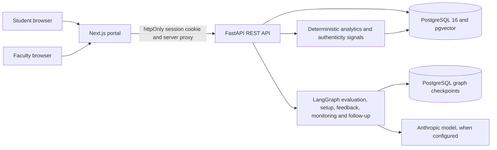

# Human-AI Co-Learning Agent

A dual-role learning platform where students submit work and receive released feedback, while faculty review AI-assisted grading and course-level learning signals. Faculty retain control of marks and release decisions.

> **Status:** Phases 0–8 implemented. See [the build plan](docs/09-BUILD-PLAN.md) for the phase checklist.

## Architecture



## Stack

- **Backend:** Python 3.11+, FastAPI, SQLAlchemy 2.x, Alembic
- **Agents:** LangGraph with PostgreSQL checkpoints; `langchain-anthropic`
- **Database:** PostgreSQL 16 with `pgvector`
- **Frontend:** Next.js 15, React 18, TypeScript and Tailwind CSS
- **Auth:** JWT held in an httpOnly Next.js cookie; the FastAPI API enforces roles and ownership

## Requirements

- Docker with Compose
- Python 3.11+ and `uv`
- Node.js and `pnpm`
- An Anthropic API key for LLM-powered setup/evaluation/feedback. Auth, seeded demo screens, and deterministic analytics can be explored without one.

## Run locally

Start PostgreSQL and apply migrations:

```bash
docker compose up -d db
cd backend
uv sync
uv run alembic upgrade head
```

Copy the root `.env.example` to `backend/.env`. The defaults match `docker-compose.yml`; add `ANTHROPIC_API_KEY` and `LLM_MODEL` to enable model calls. Then seed the demo database and start the API:

```bash
uv run python -m scripts.seed
uv run uvicorn app.main:app --reload
```

In a second terminal, copy `frontend/.env.example` to `frontend/.env.local` if the backend is not at `http://localhost:8000/api/v1`, then start Next.js:

```bash
cd frontend
pnpm install --frozen-lockfile
pnpm dev
```

Open <http://localhost:3000>. The API docs are at <http://localhost:8000/docs>.

To refresh the checked-in OpenAPI snapshot and TypeScript types after an API change:

```bash
cd backend
uv run python -m scripts.export_openapi
cd ../frontend
pnpm api:types
```

## Demo accounts and walkthrough

The seed creates one faculty account and twenty students. **All seeded answers, AI marks, final marks, feedback, and follow-up scores are synthetic demo fixtures.** These passwords are for local development only.

| Role | Email | Password |
|---|---|---|
| Faculty | `faculty@example.com` | `faculty-pass` |
| Student | `student1@example.com` through `student20@example.com` | `student-pass` |

1. Sign in as faculty and open the **Data Structures** course. Inspect its three published assignments, ten topics, and the optional process-logging control.
2. Open **Review queue** to inspect pending evaluations. Open an evaluation to see student answers, criterion evidence, editable final marks, and the faculty-only authenticity panel. Approve or send back the evaluation; release approved work when appropriate.
3. Review **Analytics**, **Score distribution**, **AI quality**, **Question quality**, and **Alerts**. Small samples display “Low data.” Use the completeness board to distinguish missing, late, under-review, and graded work.
4. Sign in as `student1@example.com`. Open an assignment, submit an answer, track its status, and inspect a released result and topic mastery.
5. Open **Follow-ups** to answer a timed understanding check. Answers are autosaved in that browser until submission.
6. Use students 15 and 16 to see near-duplicate synthetic answers; students 17 and 18 include generic responses and late submissions. Students 19 and 20 have missing work.

The seed is idempotent for a completed demo dataset: running it again verifies existing course members and skips assignments already created.

## Calibration report

From `backend/`, compare saved AI marks with the final marks stored on approved evaluations:

```bash
uv run python -m scripts.calibrate --label-source synthetic-seed
```

The script writes Markdown and CSV reports under `backend/reports/` (git-ignored). Stored seed marks are synthetic and do not measure a real model's performance. For a fresh paired re-score of up to 24 reviewed submissions, configure the LLM and use:

```bash
uv run python -m scripts.calibrate --run-ai --correction-memory both --label-source faculty-reviewed
```

The fresh run compares the same reviewed samples with correction memory disabled and enabled. It does not modify stored grades. Set `--course-id`, `--assignment-id`, and `--limit` to narrow the sample. Only label a dataset `faculty-reviewed` if those final marks were actually assigned by a faculty member.

## Known limitations

- Authenticity signals are review prompts, not proof of misconduct or AI authorship. The product never displays an AI-authorship percentage and these signals do not change marks.
- Similarity uses deterministic lexical hashing and phrase overlap; it is not a semantic embedding or plagiarism service. The optional text detector and code-provenance signal are unavailable.
- Style baselines need prior writing and can be noisy. Reports include evidence-availability caveats; the self-reported language flag only adds a caveat and never affects a mark.
- Process logging is optional and records aggregate counts/timing only. The current editor sends a session summary after submission rather than streaming every 30 seconds.
- Calibration results depend on sample size, label provenance, model/prompt version, and whether correction memory was used. Seeded labels are illustrative and must not be reported as real faculty calibration.
- The assignment creation UI is a compact first-question flow; the API supports bulk question editing. Reminder delivery and external plagiarism checks are not implemented.

See `docs/09-BUILD-PLAN.md`, `docs/10-TESTING-EVAL.md`, and `docs/DECISIONS.md` for implementation status, metric definitions, and deviations.
